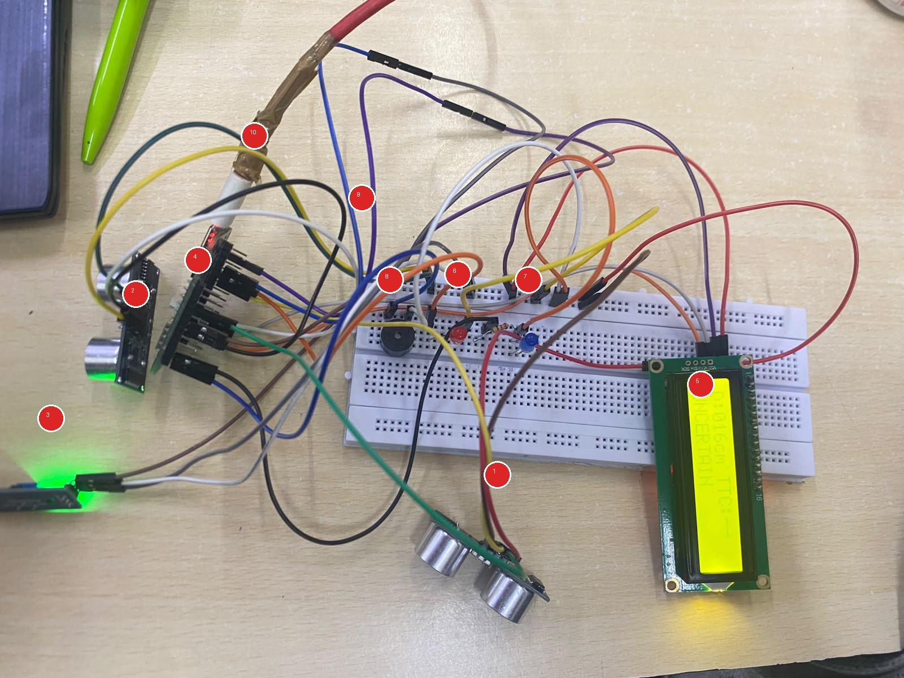
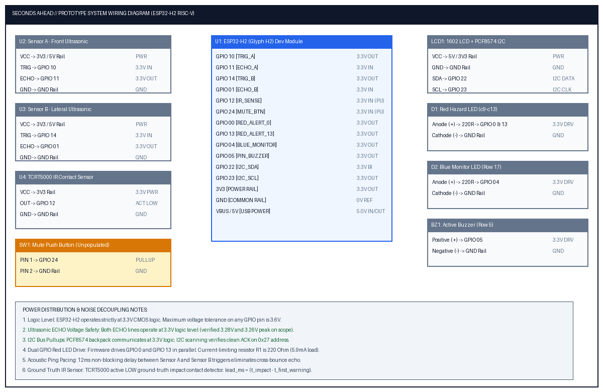

# SECONDS AHEAD (A-ADAS)

<div align="center">

### Automotive Pre-Crash Early Warning, Dual-Sector Acoustic Radar & Kinematic Telemetry Cockpit

<!-- Primary System Badges -->
[-E63946?style=flat-square&logo=espressif&logoColor=white)](https://www.espressif.com/)
[-00B4D8?style=flat-square&logo=googlechrome&logoColor=white)](https://developer.mozilla.org/en-US/docs/Web/API/Web_Serial_API)
[](https://elevenlabs.io/)
[](https://github.com/)
[](https://kicad.org/)
[](LICENSE)

<br/>

<!-- Horizontal Mini Tech Stack Icons -->
[](https://skillicons.dev)

<br/>

<!-- Performance Badges -->
[](#high-speed-telemetry-protocol)
[](#hardware-bench-wiring-and-pinout-schedule)
[](#ground-truth-physical-impact-audit)
[](#trilingual-cockpit-voice-ai)

<br/>

```
     [Front HC-SR04: Sensor A] ──┐
                                 ├──► [ESP32-H2 RISC-V SoC] ──► USB CDC UART (115200 8N1) ──► [Web Dashboard]
     [Side HC-SR04: Sensor B]  ──┤          ▲                                                        │
                                 │          │ 12ms Non-Blocking Acoustic Interleaving                ├─► Telemetry Cluster
     [TCRT5000 IR Contact: U4] ──┘          ▼                                                        ├─► 2D Kinematic Simulator
                                      [16x2 I2C LCD]                                                 └─► Trilingual Voice AI
```

</div>

---

## Table of Contents

- [Overview](#overview)
- [System Architecture](#system-architecture)
- [Key Technical Specifications](#key-technical-specifications)
- [Hardware Bench Wiring and Pinout Schedule](#hardware-bench-wiring-and-pinout-schedule)
- [Kinematics and Threat Assessment Engine](#kinematics-and-threat-assessment-engine)
- [High-Speed Telemetry Protocol](#high-speed-telemetry-protocol)
- [Telemetry Dashboard and 2D Incident Simulator](#telemetry-dashboard-and-2d-incident-simulator)
- [Trilingual Cockpit Voice AI](#trilingual-cockpit-voice-ai)
- [Ground-Truth Physical Impact Audit](#ground-truth-physical-impact-audit)
- [Getting Started](#getting-started)
- [Technical Dossier and Engineering Deliverables](#technical-dossier-and-engineering-deliverables)
- [Repository Structure](#project-structure)
- [License](#license)

---

## Overview

**SECONDS AHEAD** is an automotive pre-crash detection and active cockpit alert system engineered on the **ESP32-H2 RISC-V microcontroller**. It bridges low-level real-time acoustic sensing with an instrument-grade web telemetry cluster and neural voice synthesis to deliver verifiable collision lead time.

Standard ultrasonic parking systems suffer from severe cross-echo interference, high cycle latency, and tunnel-vision frontal coverage that leaves intersection blind spots vulnerable. SECONDS AHEAD resolves these challenges through:

1. **Dual-Sector Acoustic Radar**: Frontal longitudinal tracking (**Sensor A**, 2–100 cm) paired with an orthogonal 90° lateral sensor (**Sensor B** for intersection cross-traffic), paced with 12ms non-blocking ping interleaving to prevent ultrasonic packet collisions.
2. **Deterministic Ground-Truth Lead-Time Audit**: An integrated **TCRT5000 infrared reflective sensor (U4)** positioned at the bumper barrier records the exact microsecond timestamp of physical impact. The system automatically computes and audits the advance warning margin ($\text{lead\_ms} = t_{\text{impact}} - t_{\text{first\_warning}}$).
3. **Web Serial Telemetry Dashboard**: A zero-dependency single-file frontend running directly in Chromium-based browsers, visualizing live 20 Hz telemetry with rolling strip charts, dynamic proximity bars, and threat transition timelines.
4. **2D Kinematic Incident Simulator**: A real-time physics replayer simulating road kinematics, dual radar beam cones, lateral vehicle intrusions, safety boundaries, and collision shockwave dynamics.
5. **Trilingual Cockpit Voice AI**: Calm, authoritative ADAS audio warnings in **English**, **हिंदी (Hindi)**, and **ಕನ್ನಡ (Kannada)** powered by **ElevenLabs Creator Plan (Turbo v2.5)** with an in-memory audio object cache for **0 ms repeat latency**.

---

## System Architecture

```mermaid
graph TD
    subgraph Hardware ["Hardware Subsystem (ESP32-H2 Dev Module)"]
        SA["Sensor A: Front HC-SR04<br/>(GPIO 10 / GPIO 11)"] -->|Longitudinal Pulse| MCU["ESP32-H2 SoC<br/>(96 MHz RISC-V Core)"]
        SB["Sensor B: Lateral HC-SR04<br/>(GPIO 14 / GPIO 01)"] -->|Lateral Pulse (12ms Paced)| MCU
        IR["Sensor U4: TCRT5000 IR<br/>(GPIO 12, Active LOW)"] -->|Bumper Impact Ground Truth| MCU
        BTN["Mute Button (GPIO 24)"] -->|Audio Silence Toggle| MCU

        MCU -->|I2C Fast Mode 400kHz (GPIO 22/23)| LCD["16x2 Character LCD<br/>(PCF8574 Backpack @ 0x27)"]
        MCU -->|Dual Parallel Pin Drive (GPIO 0 & 13)| LED_R["Red Strobe LEDs (High Risk)"]
        MCU -->|Digital Out (GPIO 4)| LED_B["Blue Monitor LED"]
        MCU -->|Pulsed Tone Drive (GPIO 5)| BZ["Acoustic Piezo Buzzer"]
    end

    subgraph Telemetry ["Serial Data Stream"]
        MCU -->|USB CDC UART @ 115200 8N1 (18-20 Hz)| WS["Web Serial CDC Reader"]
    end

    subgraph Frontend ["Telemetry Dashboard & Incident Simulator (index.html)"]
        WS --> PARSER["CSV Telemetry Parser"]
        PARSER --> CLUSTER["Telemetry Instrument Cluster<br/>(Gauges, 30s Strip Chart, Range Bar, Timeline)"]
        PARSER --> SIM["2D Kinematic Canvas Simulator<br/>(Radar Cones, Car Kinematics, Shockwaves)"]
        PARSER --> AUDIT["Ground-Truth Audit Table<br/>(Lead-Time Tracker & Median Stats)"]
        PARSER --> VOICE["Neural Voice Engine<br/>(ElevenLabs Turbo v2.5 / Web Speech Fallback)"]

        VOICE -->|Audio Playback| SPK["Trilingual Cockpit Speaker<br/>(English | Hindi | Kannada)"]
        SIM -->|MediaRecorder API| VID["WebM Video Clip Exporter"]
        CLUSTER -->|Blob Exporter| CSV["Telemetry CSV Log Downloader"]
    end
```

---

## Key Technical Specifications

| Parameter | Specification | Functional Details |
| :--- | :--- | :--- |
| **Microcontroller Unit** | ESP32-H2-DevKitM-1 | 32-bit RISC-V Single-Core @ 96 MHz, Native USB CDC |
| **Operating Voltage** | 3.3V DC Logic | Onboard LDO regulator with low-impedance common ground plane |
| **Longitudinal Sensor (A)** | HC-SR04 Ultrasonic | 2 cm to 100 cm active detection range, forward cone |
| **Lateral Sensor (B)** | HC-SR04 Ultrasonic | 90° blind-spot cross-traffic monitoring |
| **Interleaving Interval** | 12 ms non-blocking delay | Eliminates cross-reflection acoustic interference between sensors |
| **Ground-Truth Detector** | TCRT5000 Optical IR | Active-low bumper impact trigger for microsecond timestamping |
| **Telemetry Interface** | USB CDC Serial (115200 baud, 8N1) | Fixed-format ASCII CSV packets streamed at 18–20 Hz |
| **Cockpit Display** | 16x2 Character LCD | PCF8574 I2C backpack @ `0x27`, 400 kHz with 30ms timeout |
| **Visual Alert Indicators** | High-Intensity 5mm LEDs | Dual Red strobes (GPIO 0, 13) + Blue monitor LED (GPIO 4) |
| **Acoustic Sounder** | 3.3V Piezo Transducer | Pulsed frequency audio alert on GPIO 5 |
| **Dashboard Architecture** | Vanilla HTML5 / CSS3 / ES6 | Single zero-dependency file (`index.html`) using Web Serial API |
| **Voice AI Synthesis** | ElevenLabs `eleven_turbo_v2_5` | Sub-300ms neural streaming synthesis with 0ms memory cache |
| **Cockpit Alert Languages** | Trilingual (EN, HI, KN) | Authoritative, non-ragebaiting ADAS driving alerts |

---

## Hardware Bench Wiring and Pinout Schedule

<div align="center">
  
  <p><em>Figure 1: SECONDS AHEAD Hardware Prototype with numbered subsystem callouts.</em></p>
</div>

### Pinout Connection Schedule

| Pin Identifier | Signal Name | Connected Peripheral | Logic Level | Direction | Operational Role |
| :---: | :---: | :---: | :---: | :---: | :--- |
| **GPIO 10** | `TRIG_A` | Front HC-SR04 (Pin 2) | 3.3V | Output | 10 µs ultrasonic burst trigger |
| **GPIO 11** | `ECHO_A` | Front HC-SR04 (Pin 3) | 3.3V | Input | Longitudinal flight pulse measurement |
| **GPIO 14** | `TRIG_B` | Lateral HC-SR04 (Pin 2) | 3.3V | Output | 12 ms interleaved lateral burst trigger |
| **GPIO 01** | `ECHO_B` | Lateral HC-SR04 (Pin 3) | 3.3V | Input | Lateral acoustic flight measurement |
| **GPIO 12** | `PIN_IR` | TCRT5000 IR Sensor (OUT) | 3.3V | Input (PU) | Active LOW physical contact detection |
| **GPIO 22** | `I2C_SDA` | LCD PCF8574 Backpack | 3.3V | Bidirectional | I2C Serial Data (400 kHz Fast Mode) |
| **GPIO 23** | `I2C_SCL` | LCD PCF8574 Backpack | 3.3V | Output | I2C Serial Clock (30 ms timeout recovery) |
| **GPIO 00 & 13** | `RED_ALERT` | Red 5mm LEDs (Dual 220Ω) | 3.3V | Output | High-current parallel drive for HIGH_RISK strobe |
| **GPIO 04** | `BLUE_MON` | Blue 5mm LED (220Ω) | 3.3V | Output | Steady illumination for MONITOR threat level |
| **GPIO 05** | `BUZZER` | Piezo Buzzer Transducer | 3.3V | Output | Pulsed audible collision alarm |
| **GPIO 24** | `MUTE_SW` | Tactile Button to GND | 3.3V | Input (PU) | Active-low cockpit buzzer mute toggle |
| **3V3 & GND** | `PWR / GND`| Power Distribution Rails | 3.3V / 0V | Power | Regulated 3.3V power and ground return |

---

## Kinematics and Threat Assessment Engine

The ESP32-H2 firmware continuously calculates relative target kinematics using rolling median filtering and first-derivative linear regression.

### Mathematical Formulation

1. **Longitudinal Distance Measurement**:
   $$d(t) = \frac{\Delta t_{\text{echo}} \times 0.0343\,\text{cm/\mu s}}{2}$$

2. **Closing Velocity Calculation**:
   $$v(t) = -\frac{d(t) - d(t - \Delta t)}{\Delta t}$$
   *(A positive velocity value denotes an object actively closing distance towards the vehicle).*

3. **Time-to-Collision (TTC)**:
   $$\text{TTC}(t) = \frac{d(t)}{v(t)}$$
   *(Computed only when $v(t) \ge 4.0\,\text{cm/s}$. Evaluated as invalid ($-1.0\,\text{s}$) when the target is static or receding).*

### Finite State Machine (FSM)

```
                            Target Observed (d <= 100 cm)
         ┌──────────────────────────────────────────────────────────────────┐
         │                                                                  │
         ▼                                                                  │
    ┌─────────┐         v < 4 cm/s          ┌──────────────┐                │
    │  WAIT   │ ──────────────────────────► │ NO APPROACH  │                │
    └─────────┘                             └──────────────┘                │
         ▲                                         │                        │
         │ No Target                               │ v >= 4 cm/s            │
         │                                         ▼                        │
         │                                  ┌──────────────┐                │
         │                                  │  UNCERTAIN   │ (Fast path)    │
         │                                  └──────────────┘                │
         │                                         │                        │
         │                                         │ Streak >= 2 & TTC > 3s │
         │                                         ▼                        │
         │                                  ┌──────────────┐                │
         │                                  │   MONITOR    │ (TTC 3.0s–5.0s)│
         │                                  └──────────────┘                │
         │                                         │                        │
         │                                         │ d < 50cm OR TTC <= 3.0s│
         │                                         ▼                        │
         │                                  ┌──────────────┐                │
         └───────────────────────────────── │  HIGH RISK   │ (Strobe/Alarm) │
              Physical Impact / Reset       └──────────────┘                │
                                                   │                        │
                                                   └────────────────────────┘
```

- **WAIT**: Target beyond 100 cm. All visual and audible alarms remain silent.
- **NO APPROACH**: Target detected within 100 cm but stationary or moving away ($v < 4\,\text{cm/s}$).
- **UNCERTAIN**: Closing motion detected ($v \ge 4\,\text{cm/s}$); establishing trajectory persistence over multiple pings.
- **MONITOR**: Verified approach trajectory with $3.0\,\text{s} < \text{TTC} \le 5.0\,\text{s}$ and $d > 50\,\text{cm}$. Solid Blue LED enabled.
- **HIGH RISK**: Critical condition where $\text{TTC} \le 3.0\,\text{s}$ or $d < 50\,\text{cm}$. Triggers 3 Hz Red strobe LEDs, pulsed audio tone, and cockpit voice alert.

---

## High-Speed Telemetry Protocol

Telemetry is transmitted over USB CDC serial at **115200 baud, 8N1** in fixed-width comma-separated ASCII records at 18–20 Hz.

### Telemetry Packet Format
```
ms,dist_cm,speed_cms,ttc_s,state,ir,muted,side_cm
14250,38.2,21.4,1.78,HIGH RISK,1,0,68.4
```

| Field Index | Key | Units | Data Type | Definition |
| :---: | :--- | :---: | :---: | :--- |
| `0` | `ms` | milliseconds | integer | System elapsed uptime via `millis()` |
| `1` | `dist_cm` | centimeters | float | Sensor A longitudinal target distance |
| `2` | `speed_cms` | cm / second | float | Target closing speed relative to host |
| `3` | `ttc_s` | seconds | float | Time to collision; `-1.0` if inactive |
| `4` | `state` | — | string | Threat level: `WAIT`, `MONITOR`, `HIGH RISK` |
| `5` | `ir` | 0 or 1 | integer | TCRT5000 bumper state: `1` = CLEAR, `0` = CONTACT |
| `6` | `muted` | 0 or 1 | integer | Cockpit sounder state: `1` = MUTED, `0` = ARMED |
| `7` | `side_cm` | centimeters | float | Sensor B lateral blind-spot distance |

### Asynchronous Event Packet
```
IR_HIT,lead_ms=3450
```
Emitted via hardware interrupt the exact millisecond the TCRT5000 optical sensor detects bumper contact, delivering an independently verifiable audit of advance warning time.

---

## Telemetry Dashboard and 2D Incident Simulator

The frontend (`index.html`) is engineered with zero external libraries or bundle dependencies. It communicates directly with the hardware through the browser's native **Web Serial API**.

<div align="center">
  
  <p><em>Figure 2: Complete Electrical Interconnect and Signal Routing Schematic.</em></p>
</div>

### Operational View Modes

1. **Dashboard View (`[DASHBOARD]`)**:
   - Four primary instrument cards: **Distance**, **Speed**, **TTC**, and **Threat State**.
   - Dual-Sector readouts for Front Sensor A and Lateral Sensor B.
   - 30-second rolling strip chart with dynamic auto-scaling and threat zone fills.
   - High-contrast horizontal range bar with color-coded critical thresholds (50 cm danger marker).
   - 60-second historical threat timeline.
   - Ground-truth IR lead-time audit log with run statistics.

2. **Incident Simulator View (`[INCIDENT SIMULATOR]`)**:
   - 2D canvas simulation displaying highway lanes, ego vehicle, oncoming traffic, and lateral blind-spot cross-traffic.
   - Dynamic radar beam projection cones with live range expansion.
   - 50 cm perimeter boundary ring.
   - Animated shockwave burst on physical bumper contact.

3. **Split View (`[SPLIT VIEW]`)**:
   - Synchronized side-by-side display linking live telemetry readouts on the left with 2D kinematic canvas rendering on the right.

### Operator Features
- **Baud Rate Selector**: Configurable connection speeds (9600 to 921600 baud; default `115200`).
- **Interactive Console**: Slide-over raw serial terminal for inspecting streaming CSV strings and sending diagnostic commands.
- **Scenario Replayer**: Built-in test profiles (*Head-On Approach*, *Lateral Intrusion*, *Multi-Threat Scenario*) with variable playback rate (`0.5X`, `1X`, `2X`).
- **Video Clip Exporter (`RECORD CLIP`)**: Captures 30 FPS canvas streams directly to `.webm` video files.
- **Data Export (`EXPORT CSV`)**: Exports all captured session data with timestamps.

---

## Trilingual Cockpit Voice AI

The audio subsystem integrates the **ElevenLabs Creator Plan (`eleven_turbo_v2_5`)** to deliver calm, automotive-grade ADAS warning alerts. Phrasing is deliberately engineered to remain composed and authoritative, avoiding distracting repetitions or panic-inducing prompts.

<div align="center">

| Trigger Condition | English Prompt | हिंदी (Hindi) Prompt | ಕನ್ನಡ (Kannada) Prompt |
| :--- | :--- | :--- | :--- |
| **System Armed** | *"Collision warning system active."* | *"टक्कर चेतावनी प्रणाली सक्रिय है।"* | *"ಡಿಕ್ಕಿ ಎಚ್ಚರಿಕೆ ವ್ಯವಸ್ಥೆ ಸಕ್ರಿಯವಾಗಿದೆ."* |
| **High Collision Risk** | *"Caution. Collision risk ahead. Please brake."* | *"सावधान। आगे टक्कर का ख़तरा है। कृपया ब्रेक लगाएं।"* | *"ಎಚ್ಚರಿಕೆ. ಮುಂದೆ ಡಿಕ್ಕಿಯಾಗುವ ಸಾಧ್ಯತೆಯಿದೆ. ದಯವಿಟ್ಟು ಬ್ರೇಕ್ ಹಾಕಿ."* |
| **Oncoming Vehicle** | *"Vehicle approaching ahead."* | *"आगे से वाहन आ रहा है।"* | *"ಮುಂದೆ ವಾಹನ ಸಮೀಪಿಸುತ್ತಿದೆ."* |
| **Lateral Blind Spot** | *"Caution. Vehicle in side blind spot."* | *"सावधान। बगल में वाहन आ रहा है।"* | *"ಎಚ್ಚರಿಕೆ. ಪಕ್ಕದ ಬ್ಲೈಂಡ್ ಸ್ಪಾಟ್‌ನಲ್ಲಿ ವಾಹನವಿದೆ."* |

</div>

- **Language Selection**: Seamlessly switch between English, Hindi, and Kannada via the top-bar dropdown.
- **Zero-Latency In-Memory Caching**: Audio blobs are synthesized on initial trigger and cached as reusable browser audio objects, providing **0 ms latency** and zero additional API credit usage on subsequent triggers.
- **Offline Fallback**: If internet connectivity is interrupted, the system automatically falls back to native browser speech synthesis (`SpeechSynthesisUtterance`).

---

## Ground-Truth Physical Impact Audit

To provide definitive mathematical proof of safety efficacy for automotive judges and evaluators, SECONDS AHEAD implements a hardware-based ground-truth audit:

$$\text{Warning Lead Time } (\text{lead\_ms}) = t_{\text{contact}} - t_{\text{first\_high\_risk\_alert}}$$

```
Time Axis (ms) ──────────────────────────────────────────────────────────►
0 ms                  12,100 ms                           15,550 ms
│                     │                                   │
▼                     ▼                                   ▼
Approach Begins       HIGH RISK State Triggered           TCRT5000 Physical Impact
                      [Voice Alert + Strobes Fire]        [IR_HIT Event Logged]
                      └───────────────── 3,450 ms ───────┘
                                     Advance Warning Margin
```

Every run is indexed in the dashboard audit log, recording run count, target speed at initial warning, distance at warning, and verified lead time in milliseconds.

---

## Getting Started

### 1. Flash Firmware to ESP32-H2
1. Open `firmware/firmware.ino` in the Arduino IDE.
2. Select **Board**: `ESP32H2 Dev Module`.
3. Configure **USB CDC On Boot**: `Enabled`.
4. Install the required dependency `LiquidCrystal_I2C` via the Library Manager.
5. Connect your ESP32-H2 via USB-C and click **Upload**.

### 2. Launch the Web Dashboard
1. Open `index.html` in a Web Serial-compatible browser (Google Chrome, Microsoft Edge, or Opera).
2. Click **`CONNECT`** in the top control bar.
3. Select the ESP32-H2 USB serial device from the browser permission prompt.
4. Telemetry will begin streaming immediately at ~20 Hz.

### 3. Run Standalone Demonstration (No Hardware Required)
1. Open `index.html` in your browser.
2. Click **`DEMO`** in the top bar to generate synthetic dual-radar telemetry.
3. Select **`SPLIT VIEW`** or **`INCIDENT SIMULATOR`** to observe vehicle physics and radar cones reacting in real time.
4. Click **`▶ PLAY VIDEO`** to test simulated pre-crash scenarios.

---

## Technical Dossier and Engineering Deliverables

The repository includes a comprehensive five-part engineering submission dossier located in the `documentation/` directory:

1. **Schematic & Wiring Diagram**: [1_SCHEMATIC_AND_WIRING_DIAGRAM.pdf](documentation/1_SCHEMATIC_AND_WIRING_DIAGRAM.pdf)
2. **Annotated PCB Layout**: [2_PCB_LAYOUT_ANNOTATED.pdf](documentation/2_PCB_LAYOUT_ANNOTATED.pdf)
3. **Hardware Prototype Photography**: [3_BUILT_HARDWARE_ANNOTATED_PHOTOS.pdf](documentation/3_BUILT_HARDWARE_ANNOTATED_PHOTOS.pdf)
4. **Telemetry Dashboard & Simulator Overview**: [4_TELEMETRY_DASHBOARD_AND_SIMULATOR_SCREENS.pdf](documentation/4_TELEMETRY_DASHBOARD_AND_SIMULATOR_SCREENS.pdf)
5. **Bring-Up & Safety Validation Checklist**: [5_BRING_UP_AND_SAFETY_CHECKLIST.pdf](documentation/5_BRING_UP_AND_SAFETY_CHECKLIST.pdf)

---

## Project Structure

```
SECONDS-AHEAD/
├── firmware/
│   └── firmware.ino                    # ESP32-H2 C++ Arduino Firmware
├── index.html                          # Telemetry Dashboard, Simulator & Voice AI
├── annotated_hardware_top.jpg          # Hardware Prototype Photograph with Callouts
├── build_submission_dossier.py         # Automated ReportLab PDF Dossier Generator
├── documentation/
│   ├── 1_SCHEMATIC_AND_WIRING_DIAGRAM.pdf
│   ├── 2_PCB_LAYOUT_ANNOTATED.pdf
│   ├── 3_BUILT_HARDWARE_ANNOTATED_PHOTOS.pdf
│   ├── 4_TELEMETRY_DASHBOARD_AND_SIMULATOR_SCREENS.pdf
│   ├── 5_BRING_UP_AND_SAFETY_CHECKLIST.pdf
│   ├── kicad_schematic_clean.png
│   └── vector_wiring_diagram.png
├── kicad/
│   ├── seconds_ahead.kicad_pro         # KiCad 8.0 Project File
│   ├── seconds_ahead.kicad_pcb         # 2-Layer PCB Layout
│   └── seconds_ahead-rev-33.deeppcb    # Auto-routed PCB Artifact
└── README.md                           # Technical Documentation
```

---

## License

This project is released under the **MIT License**. You are free to inspect, modify, and deploy this architecture for academic, automotive safety, and embedded research applications.
